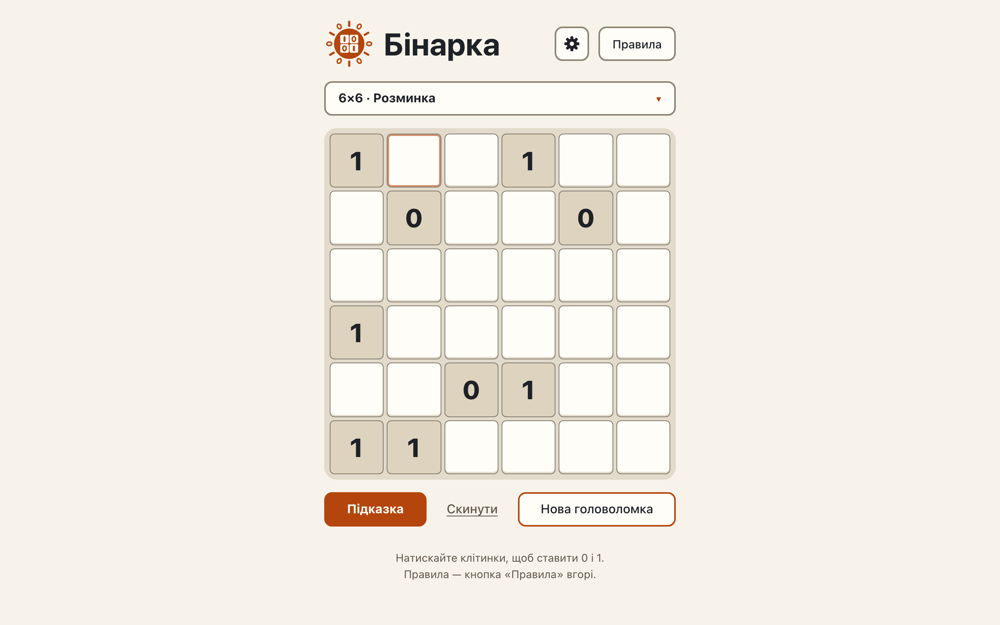

# The play page shows a generated puzzle: givens, cycling cells, header, logo, messages

**Proves:** FR-13, FR-14, FR-15, FR-31, FR-32, FR-33, FR-34, FR-63, FR-68, FR-71, FR-72

**Result:** asserted ✓

**Video:** [01-play-board.webm](01-play-board.webm) · recorded by `scripts/record-demos.mjs` against its own `vite preview` of the built page.

## Assertions, in order

1. FR-31: the page shows a 6×6 grid by default
2. FR-13: the board is the generator's 6×6 puzzle for seed 1546675241, level 1: givens 0 or 1, the rest empty
3. FR-15: the shown givens have exactly one solution (countSolutions = 1)
4. FR-32: every given carries data-given="true" and cell-given; no other cell does
5. FR-14: the same seed gives the identical puzzle after a reload, and in the engine
6. FR-33: a click on the given at row 1, column 1 leaves it as it was
7. FR-34: clicks on row 1, column 2 show «0», «1», then empty
8. FR-68: document order: header (title, settings, rules), summary, board, hint/reset/new, idle/hint/win; the sheet, panels and dialog outside it
9. FR-63: the hint and win messages have role="status", are present and empty, and are rendered (not display: none)
10. FR-71: the idle line shows «Натискайте клітинки, щоб ставити 0 і 1. …» (U+00A0 around «і»), visible while both messages are empty, with no role
11. FR-72: the header logo is an inline SVG (no image file), aria-hidden, no text: a 2×2 board of two bars (1) and two rings (0)

