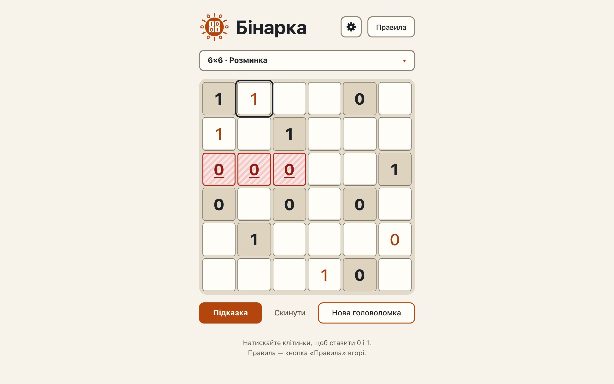

# Cells are buttons: Tab order, Enter and Space, labels, roles and the focus ring

**Proves:** FR-59, FR-60, FR-61, FR-62, FR-65, FR-69, FR-70

**Result:** asserted ✓

**Video:** [02-keyboard-a11y.webm](02-keyboard-a11y.webm) · recorded by `scripts/record-demos.mjs` against its own `vite preview` of the built page.

## Assertions, in order

1. FR-69: every cell is a <button type="button">; a given has aria-disabled="true" and no disabled attribute
2. FR-61: the board is role="group" «Поле 6×6», its children are its cells (no role), aria-invalid exactly on the violation the engine reports
3. FR-70: every cell is labelled «Рядок R, стовпець C, V» with «, задано» on givens (e.g. «Рядок 1, стовпець 1, 1, задано»)
4. FR-59: no element of the page has a tabindex
5. FR-59: each cell is its own Tab stop, row by row, after the summary button and before «Підказка»
6. FR-60: Enter gives «0», Space «1», the cell keeps the focus; on a given both change nothing
7. FR-59: arrows, Home, End, PageDown, Escape and letters neither move the focus nor change a cell
8. FR-70: the label follows the change of the cell («Рядок 1, стовпець 2, 1»)
9. FR-62: the size radiogroup is named «Розмір поля» by aria-label, each size button by its own text, and no visible text says «Розмір поля»
10. FR-65: the keyboard focus ring shows (contrast 14.58:1 to the page), the cell border 3.77:1, givens weigh 800 against 500

