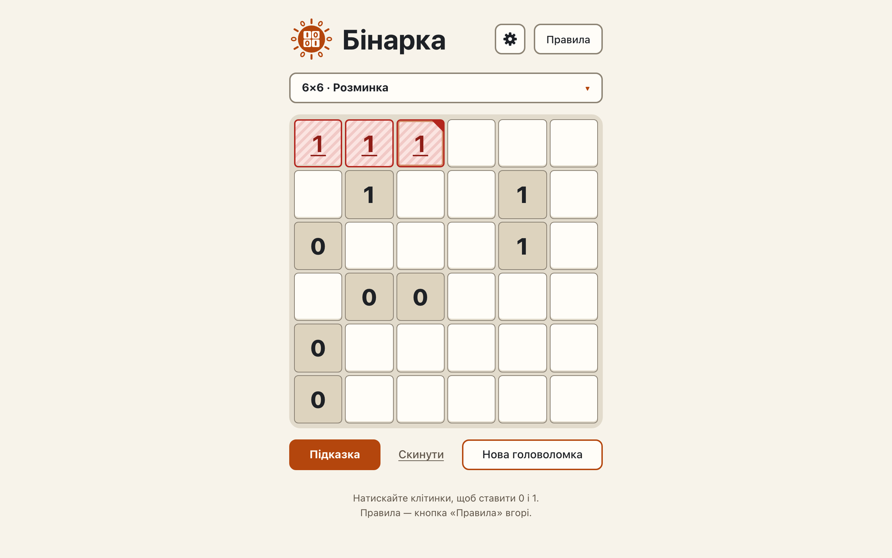

# The rule checker on the page: runs, counts and identical lines are highlighted, live

**Proves:** FR-1, FR-2, FR-3, FR-4, FR-5, FR-6, FR-7, FR-35, FR-36, FR-37, FR-38, FR-64, FR-120

**Result:** asserted ✓

**Video:** [03-violations.webm](03-violations.webm) · recorded by `scripts/record-demos.mjs` against its own `vite preview` of the built page.

## Assertions, in order

1. FR-1: the checker reports three equal digits side by side in a row (row 1)
2. FR-35: the page highlights exactly those cells (3)
3. FR-2: the checker reports three equal digits side by side in a column (col 1)
4. FR-35: the page highlights exactly those cells (3)
5. FR-3: the checker reports a row with more than N/2 of one digit, incomplete (row 1)
6. FR-36: the page highlights exactly those cells (6)
7. FR-4: the checker reports a column with more than N/2 of one digit, incomplete (col 2)
8. FR-36: the page highlights exactly those cells (6)
9. FR-5: the checker reports two complete identical rows (row 1 and 5)
10. FR-37: the page highlights exactly those cells (12)
11. FR-6: the checker reports two complete identical columns (col 5 and 6)
12. FR-37: the page highlights exactly those cells (12)
13. FR-7: empty cells count as no digit: no violation and no highlight on a rule-clean partial board
14. FR-38: after the first click nothing is highlighted; after the second the run is highlighted at once
15. FR-120: exactly one cell carries cell-cause: the clicked cell (row 1, column 3), which is also in the violation
16. FR-64: a violation cell has a heavier border (2px against 1px); the cause cell has a corner mark in the violation border colour
17. FR-38: once the rule is no longer broken, its highlight disappears
18. FR-120: the cause marker is removed by the next board change

