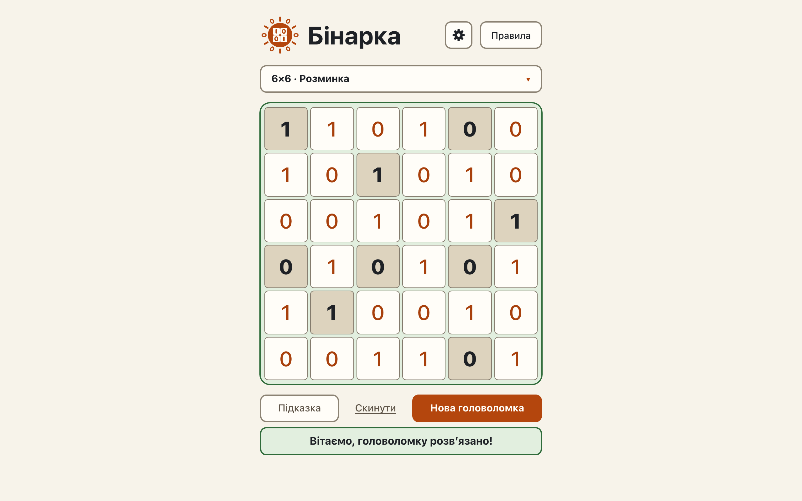

# Capture boards, the solver count and the win message

**Proves:** FR-8, FR-9, FR-10, FR-11, FR-12, FR-41, FR-119

**Result:** asserted ✓

**Video:** [04-capture-board-and-win.webm](04-capture-board-and-win.webm) · recorded by `scripts/record-demos.mjs` against its own `vite preview` of the built page.

## Assertions, in order

1. FR-10: the solver reports 0 for givens with no completion; the page ignores that value and shows the generated puzzle
2. FR-12: the solver stops at the second solution and reports 2; the page ignores that value too
3. FR-11: the solver reports 1 for the fixture givens; the page shows exactly that board
4. FR-119: the capture board takes the place of the first puzzle: its level in the summary («6×6 · Задачка»), its violations highlighted
5. FR-9: a grid with an empty cell is not solved: no win message
6. FR-9: a full grid with a violation is not solved: no win message, the violation is highlighted
7. FR-8: every cell filled, no violation: the grid is recognised as solved
8. FR-41: the win message is exactly «Вітаємо, головоломку розвʼязано!» with U+02BC
9. FR-119: a capture board that is already solved shows the win state at mount

