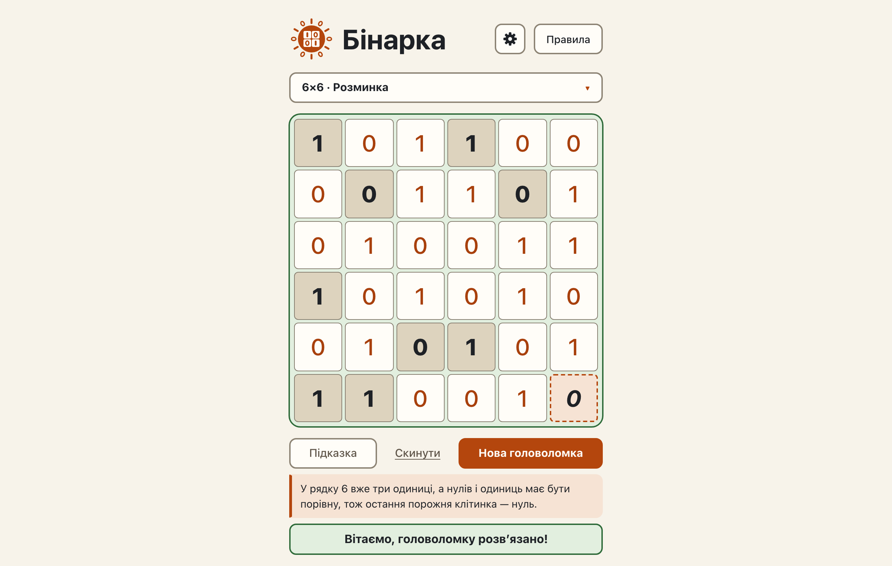

# Hints: pair, sandwich and count, the hinted cell, the broken-rule sentence, solving by hints

**Proves:** FR-19, FR-20, FR-21, FR-22, FR-23, FR-24, FR-26, FR-27, FR-39, FR-40, FR-66

**Result:** asserted ✓

**Video:** [05-hints-basic.webm](05-hints-basic.webm) · recorded by `scripts/record-demos.mjs` against its own `vite preview` of the built page.

## Assertions, in order

1. FR-19: the hint is the pair rule: «Два нулі поспіль у стовпці 4, тож поруч може стояти лише одиниця, бо три однакові цифри поспіль заборонені.»
2. FR-39: it fills row 4, column 4 with 1
3. FR-66: that cell, and only it, carries cell-hinted
4. FR-24: the target was empty, and no given or filled cell changed
5. FR-22: the sentence names the line of the target cell: «стовпці 4»
6. FR-40: the sentence is in the page language (Ukrainian)
7. FR-23: the same board gives the same hint again: same cell, value and sentence
8. FR-66: a click on another cell removes the hinted marker
9. FR-20: the hint is the sandwich rule: «Між двома нулями у стовпці 1 може стояти лише одиниця, бо три однакові цифри поспіль заборонені.»
10. FR-39: it fills row 5, column 1 with 1
11. FR-66: that cell, and only it, carries cell-hinted
12. FR-24: the target was empty, and no given or filled cell changed
13. FR-22: the sentence names the line of the target cell: «стовпці 1»
14. FR-40: the sentence is in the page language (Ukrainian)
15. FR-21: the hint is the count rule: «У рядку 5 вже три одиниці, а нулів і одиниць має бути порівну, тож решта порожніх клітинок — нулі.»
16. FR-39: it fills row 5, column 4 with 0
17. FR-66: that cell, and only it, carries cell-hinted
18. FR-24: the target was empty, and no given or filled cell changed
19. FR-22: the sentence names the line of the target cell: «рядку 5»
20. FR-40: the sentence is in the page language (Ukrainian)
21. FR-26: the broken-rule sentence: «Спершу виправте порушення правил, підсвічене на полі.»; no cell is filled
22. FR-27: the givens reach the solution in 27 hints, each a pair, sandwich or count fill, never «no rule»; the page shows the win

