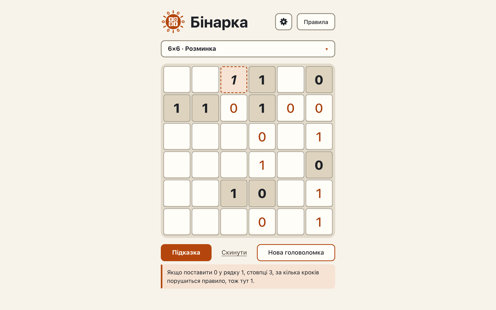

# Hints: line balance, unique lines and look-ahead, the lowest technique first

**Proves:** FR-74, FR-75, FR-76, FR-77, FR-78, FR-79, FR-80

**Result:** asserted ✓

**Video:** [06-hints-advanced.webm](06-hints-advanced.webm) · recorded by `scripts/record-demos.mjs` against its own `vite preview` of the built page.

## Assertions, in order

1. FR-74: the page fills row 6, column 3 with 0 by balance
2. FR-78: one sentence: «У стовпці 3 є місце лише для однієї одиниці, і якщо поставити її сюди, решта клітинок дасть три однакові цифри поспіль, тож тут нуль.»
3. FR-77: no technique below 2 applies here (ceiling 1 gives «Жодне з правил зараз не підказує наступного ходу.»), so the page picks balance
4. FR-75: the page fills row 2, column 1 with 1 by unique
5. FR-79: one sentence: «Стовпець 1 збігається з повним стовпцем 3 усюди, крім двох порожніх клітинок, тож тут має бути 1, інакше ці стовпці були б однакові.»
6. FR-77: no technique below 3 applies here (ceiling 2 gives «Жодне з правил зараз не підказує наступного ходу.»), so the page picks unique
7. FR-76: the page fills row 1, column 3 with 1 by lookahead
8. FR-80: one sentence: «Якщо поставити 0 у рядку 1, стовпці 3, за кілька кроків порушиться правило, тож тут 1.»
9. FR-77: no technique below 4 applies here (ceiling 3 gives «Жодне з правил зараз не підказує наступного ходу.»), so the page picks lookahead, also on a level 1 board
10. FR-80: the look-ahead sentence names the cell by its row and its column

