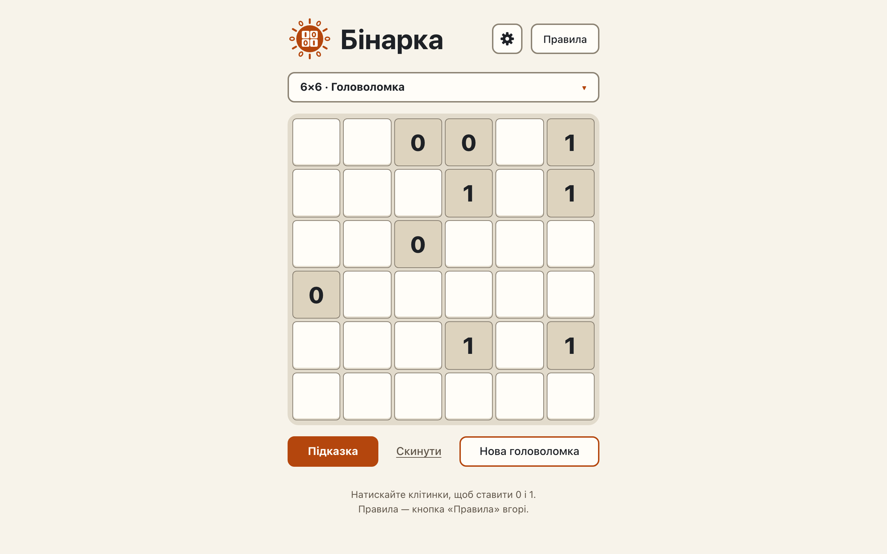

# Levels: an 8×8 «Мозколамка» and a 6×6 «Головоломка» are exactly their level, with one solution

**Proves:** FR-14, FR-15, FR-44, FR-82, FR-83, FR-88

**Result:** asserted ✓

**Video:** [07-levels-generator.webm](07-levels-generator.webm) · recorded by `scripts/record-demos.mjs` against its own `vite preview` of the built page.

## Assertions, in order

1. FR-88: «Розминка» is the level at start
2. FR-44: the page offers level 4 at 8×8 and shows that puzzle
3. FR-14: the board equals the engine's puzzle for (8, seed 1138051246, level 4), the same on every call
4. FR-15: the givens shown have exactly one solution
5. FR-82: the board is solvable with techniques 1 to 4 and not with 1 to 3
6. FR-83: the solution for (8, seed 1138051246) is the same at every level the engine builds (4 levels compared)
7. FR-44: the page offers level 3 at 6×6 and shows that puzzle
8. FR-14: the board equals the engine's puzzle for (6, seed 1305924672, level 3), the same on every call
9. FR-15: the givens shown have exactly one solution
10. FR-82: the board is solvable with techniques 1 to 3 and not with 1 to 2
11. FR-83: the solution for (6, seed 1305924672) is the same at every level the engine builds (4 levels compared)
12. FR-88: size, level and the marked choice are never stored (localStorage holds no key)

