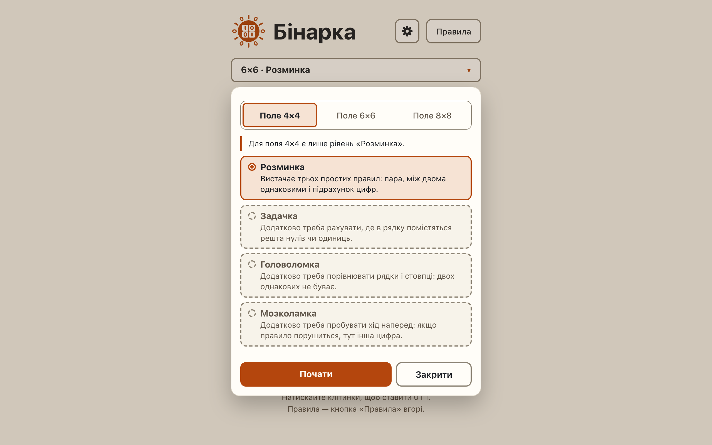

# The setup sheet: summary button, marking a size and a level, the 4×4 rule, closing and «Почати»

**Proves:** FR-43, FR-73, FR-87, FR-89, FR-91, FR-92, FR-95, FR-96, FR-97, FR-99, FR-100, FR-101

**Result:** asserted ✓

**Video:** [08-setup-sheet.webm](08-setup-sheet.webm) · recorded by `scripts/record-demos.mjs` against its own `vite preview` of the built page.

## Assertions, in order

1. FR-95: the summary button «6×6 · Розминка ▾» opens the sheet by popovertarget; the ▾ cue is aria-hidden
2. FR-96: the sheet is a popover dialog «Поле і складність» holding size, level, «Почати», «Закрити», outside the board
3. FR-43: the size group holds «Поле 4×4», «Поле 6×6», «Поле 8×8» radio buttons, 6×6 checked
4. FR-87: the level group «Складність» holds «Розминка», «Задачка», «Головоломка», «Мозколамка», «Розминка» checked
5. FR-89: each level button holds its name and its description (two spans, no id); no separate description line
6. FR-99: no aria-label, -labelledby or -describedby on a level button; each at least 44 px tall
7. FR-73, FR-97, FR-100: a press only marks: aria-checked moves, the sheet stays open, the focus stays on the pressed button, no dialog, the board and summary unchanged
8. FR-91: marking 4×4 marks «Розминка»; levels 2 to 4 carry aria-disabled="true"; the reason line «Для поля 4×4 є лише рівень «Розминка».» shows
9. FR-73: a press on an unavailable level does nothing
10. FR-92: marking 6×6 afterwards removes aria-disabled and the reason and keeps «Розминка»
11. FR-97, FR-100: closing changes nothing, focus ends on the summary button, and reopening shows 6×6 · Розминка again
12. FR-101: «Почати» closes the sheet, starts one 8×8 «Задачка» puzzle (the next seed) with no dialog, updates the summary and focuses it
13. FR-92: one «Почати» made one new puzzle with both the marked size and the marked level

