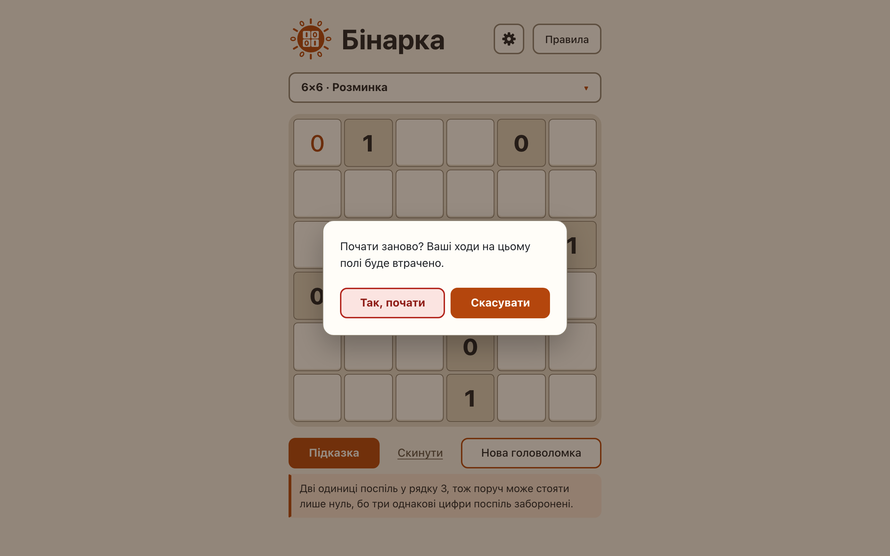

# «Нова головоломка», «Скинути» and «Почати» ask before discarding moves

**Proves:** FR-42, FR-58, FR-67, FR-90, FR-98

**Result:** asserted ✓

**Video:** [09-confirm-actions.webm](09-confirm-actions.webm) · recorded by `scripts/record-demos.mjs` against its own `vite preview` of the built page.

## Assertions, in order

1. FR-58: on an untouched board «Скинути» opens no dialog and changes nothing
2. FR-67: a modal <dialog> asks «Почати заново? Ваші ходи на цьому полі буде втрачено.» with «Так, почати» and «Скасувати» (focused)
3. FR-67: «Скасувати» closes it and leaves the board and the hint message as they were
4. FR-42: «Так, почати» shows a new puzzle of the same size and level (the next seed) and clears the messages and the hinted marker
5. FR-67: «Скинути» asks too, because the board has entries
6. FR-58: every non-given cell is empty (the hint fill too), givens, size and level kept, the hint message and marker cleared
7. FR-98: the sheet is closed before the dialog opens; they are never open together
8. FR-90: «Скасувати»: board, size, level and summary unchanged, the pending start dropped, focus on the summary, the sheet not reopened
9. FR-98: «Так, почати» performs the start marked at the press: an 8×8 board, the summary updated, focus on it
10. FR-90: the dialog is closed again after «Так, почати»; «Почати» asked only because the board had entries

