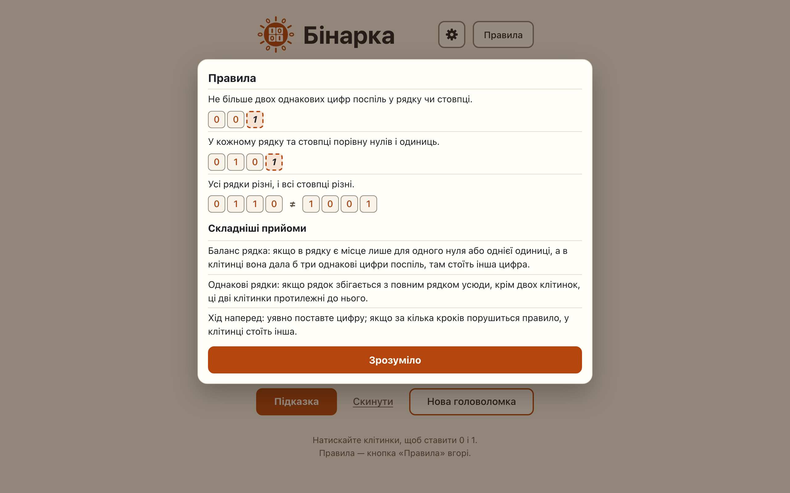

# The rules panel: three rules and three harder techniques, every text from strings.ts

**Proves:** FR-57, FR-93, FR-94

**Result:** asserted ✓

**Video:** [10-rules-panel.webm](10-rules-panel.webm) · recorded by `scripts/record-demos.mjs` against its own `vite preview` of the built page.

## Assertions, in order

1. FR-57: the header button «Правила» opens the popover panel «Правила» with exactly the three rules and «Зрозуміло»; no 
, outside the board
2. FR-93: after the rules: «Складніші прийоми» and three one-sentence items, for line balance, matching lines and look-ahead
3. FR-57: «Зрозуміло» closes the panel
4. FR-94: every Ukrainian text and name on the page (47) comes from src/ui/strings.ts; no Cyrillic in the other src/ui modules or src/main.ts

