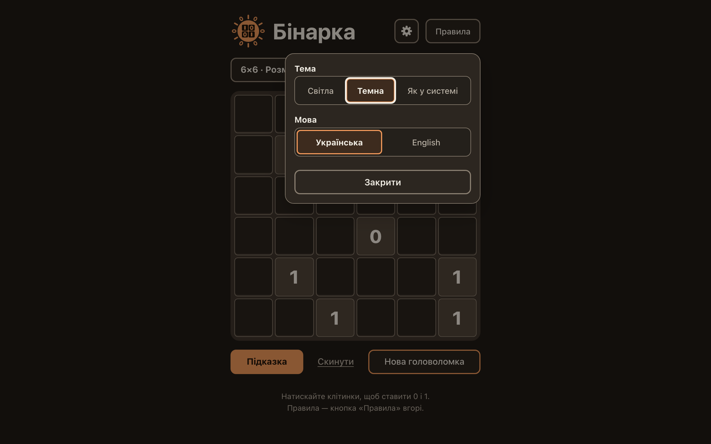

# The theme: light, dark or the system, applied before the first paint, stored, safe when storage fails

**Proves:** FR-102, FR-103, FR-104, FR-105, FR-106, FR-113, FR-114, FR-115, FR-116, FR-117, FR-118

**Result:** asserted ✓

**Video:** [11-theme.webm](11-theme.webm) · recorded by `scripts/record-demos.mjs` against its own `vite preview` of the built page.

## Assertions, in order

1. FR-102: the radiogroup «Тема» in the settings panel: «Світла», «Темна», «Як у системі» (checked)
2. FR-117: every option is a <button type="button" role="radio"> named by its text, at least 44×44 CSS px, no tabindex
3. FR-105: while auto, a system change to dark and back is followed at once (data-theme, color-scheme)
4. FR-106: one theme-color meta, equal to --color-page of the effective theme (#f7f3ea light, #1a1714 dark)
5. FR-104: <html data-theme="dark"> and color-scheme dark
6. FR-103: the press moves aria-checked, keeps the board, summary and focus, and opens or closes nothing
7. FR-113: exactly one write, binarka.theme = dark; a press on the chosen option writes nothing; no other key
8. FR-117: Enter and Space act as native button activation; the focus stays on the option
9. FR-105: while the choice is dark, a system change does nothing
10. FR-116: at the first <body>, before the page module mounts: data-theme dark, lang uk, title «Бінарка», the dark theme-color
11. FR-114: «Dark» and «ru» fall back to auto and Ukrainian, and stay stored as they were
12. FR-115: localStorage throws on access: the page mounts with the defaults, a press applies dark for the session, no uncaught error
13. FR-118: opening the settings closes the sheet (popover auto) and discards the mark; the theme press acted at once

