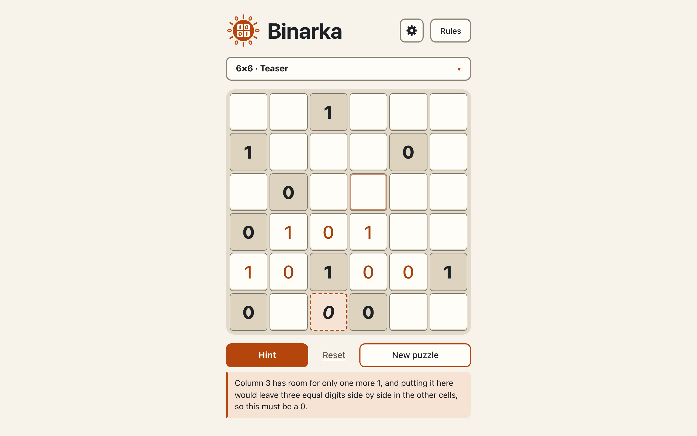

# English: the language switch re-renders every text in place, hints included

**Proves:** FR-22, FR-40, FR-55, FR-56, FR-107, FR-108, FR-109, FR-110, FR-111, FR-112

**Result:** asserted ✓

**Video:** [12-english.webm](12-english.webm) · recorded by `scripts/record-demos.mjs` against its own `vite preview` of the built page.

## Assertions, in order

1. FR-55: the page starts in Ukrainian
2. FR-107: the radiogroup «Мова» after the theme group: «Українська» (lang uk, checked) and «English» (lang en)
3. FR-109: <html lang="en">, document.title and the header title "Binarka"
4. FR-110: the hint on screen is the same hint (same technique, line and cell) in English
5. FR-108: board, entries and hinted cell stay; every cell label and the board name are English; stored as en; the focus stays on «English»
6. FR-111: every page text has its English counterpart from the EN table: buttons, idle line, summary, sheet, groups, sizes, levels, rules, techniques, dialog, theme and settings texts
7. FR-108: the switch re-rendered every page text and accessible name without a reload
8. FR-40: in English mode the hint shows the English sentence: «Two zeros side by side in column 4, so only a one can go next to them, because three equal digits side by side are not allowed.»
9. FR-22: the English sentence names the line: "row 5"
10. FR-112: the engine returns English sentences for pair, sandwich, count, line balance, unique lines, look-ahead and broken-rule (the no-rule one is in the CLI clip), each naming row or column and its number, no Cyrillic, no apostrophe
11. FR-56: hint sentences are available in English (pointer row to FR-110 and FR-112)

