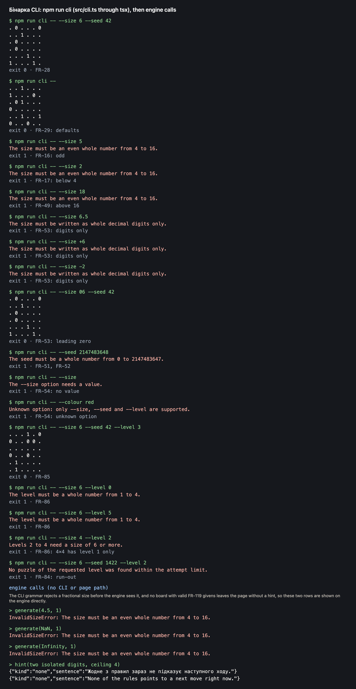

# The CLI (npm run cli) prints puzzles and English errors; engine calls with no page or CLI path

**Proves:** FR-16, FR-17, FR-25, FR-28, FR-29, FR-30, FR-49, FR-50, FR-51, FR-52, FR-53, FR-54, FR-81, FR-84, FR-85, FR-86

**Result:** asserted ✓

**Video:** [13-cli-engine.webm](13-cli-engine.webm) · recorded by `scripts/record-demos.mjs` against its own `vite preview` of the built page (this clip runs `src/cli.ts` through tsx, as `npm run cli` does, and shows the output on a terminal page).

## Assertions, in order

1. FR-28: `--size 6 --seed 42` prints 6 lines of 6 space-separated tokens (0, 1 or .), the engine puzzle for that seed
2. FR-29: no options means size 6 and seed 1
3. FR-16, FR-30: an odd size: one English sentence on stderr, exit non-zero, nothing on stdout
4. FR-17, FR-30: a size below 4 is rejected the same way
5. FR-49, FR-30: a size above 16 is rejected the same way
6. FR-53, FR-30: `6.5`, `+6`, `-2`, `1e1`, `0x6` and an empty value are not whole decimal digits
7. FR-53: `06` means 6
8. FR-51, FR-52: a seed above 2147483647: one English sentence on stderr, exit non-zero, nothing on stdout
9. FR-52: a seed that is not digits is rejected the same way
10. FR-54: an option without a value and an unknown option: one English sentence each, exit non-zero
11. FR-85: `--level 3` prints the level 3 puzzle in the same shape; without `--level` the output is byte-identical to `--level 1`
12. FR-86: levels 0, 5, 1.5, an empty or missing value, and level 2 at size 4: an English sentence on stderr, exit non-zero, nothing on stdout
13. FR-81: the generator rejects a level outside 1 to 4, and a level above 1 at N = 4
14. FR-84: after 100 attempts (6, seed 1422, level 2) the generator throws its own run-out error and returns no puzzle; the CLI prints it
15. FR-50: a size that is not an integer (4.5, NaN, Infinity) is rejected with an error, no puzzle returned
16. FR-25: when no technique applies the hint targets no cell and says «Жодне з правил зараз не підказує наступного ходу.» (in English too)

