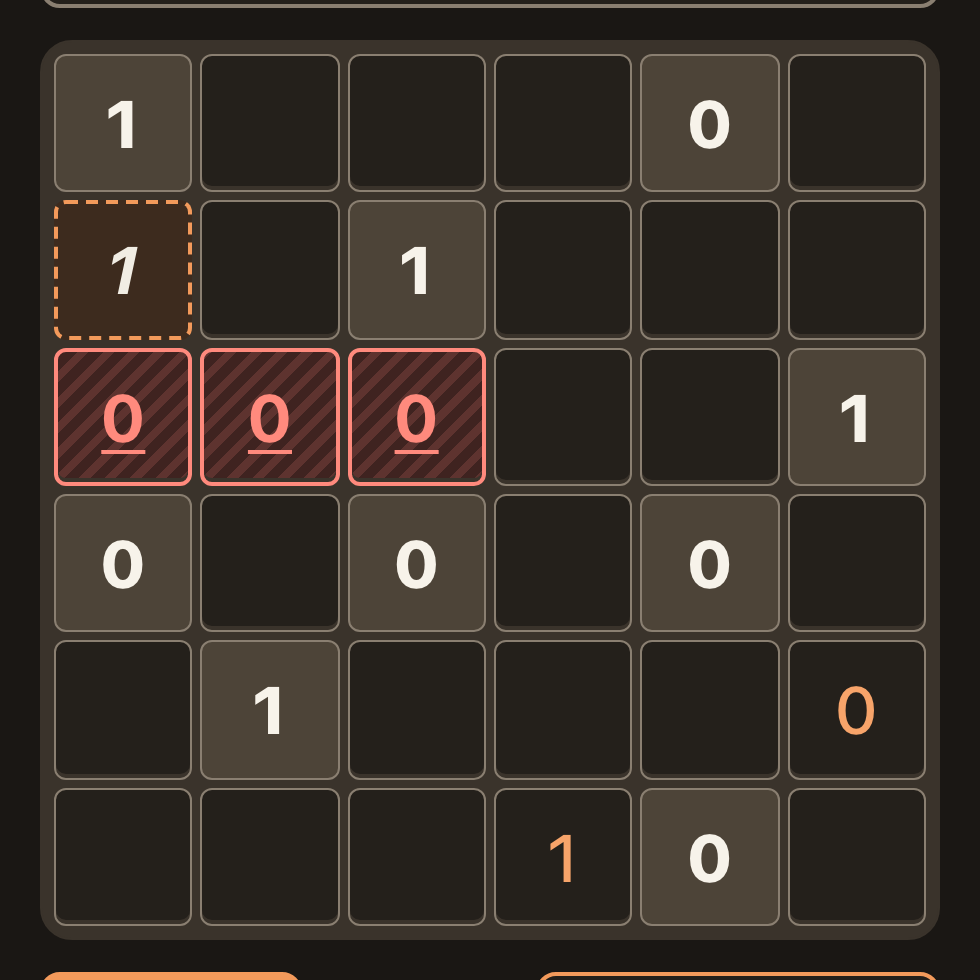

# NFR-11, dark: a violation, a given, a player entry and the hinted cell, each with a non-colour cue

**Proves:** NFR-11, FR-32, FR-64, FR-66

**Result:** asserted ✓

**Video:** [15-cell-states-dark.webm](15-cell-states-dark.webm) · recorded by `scripts/record-demos.mjs` against its own `vite preview` of the built page.

## Assertions, in order

1. NFR-11: the board shows all four states in the dark scheme (3 violation, 9 given, 2 entry, 1 hinted)
2. NFR-11: each state differs from the others by a non-colour property: violation 2px underline with stripes, given weight 800, entry weight 500, hinted dashed italic
3. FR-32: givens are told from player cells by weight (800 against 500)
4. FR-64: a violation cell has a heavier border than an ordinary cell
5. FR-66: exactly one cell, row 2 column 1, carries cell-hinted

